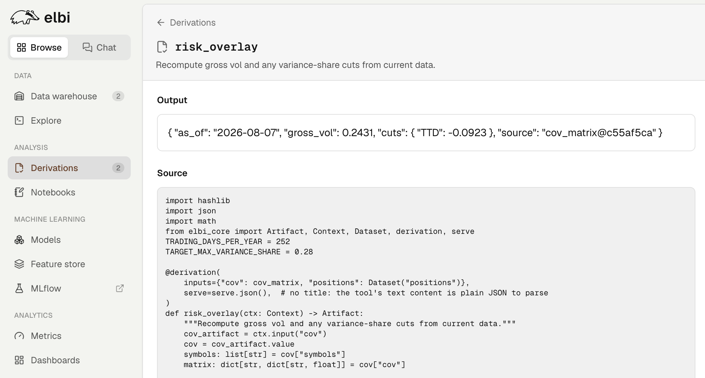
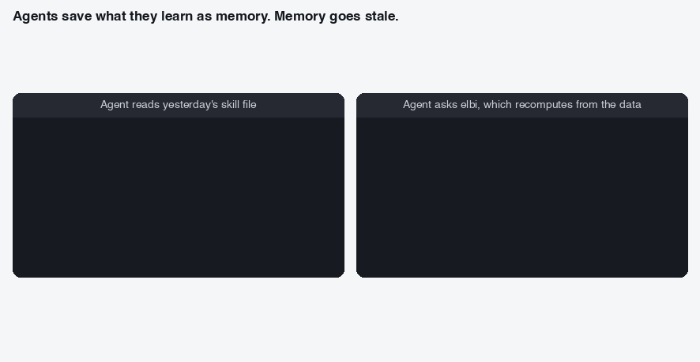

<p align="center">
  <picture>
    <source media="(prefers-color-scheme: dark)" srcset="./docs/assets/logo-dark.svg">
    
  </picture>
</p>

<p align="center">
  <a href="https://github.com/Intelligible/elbi/actions/workflows/ci.yml"></a>
  <a href="https://pypi.org/project/elbi/"></a>
  <a href="https://pypi.org/project/elbi/"></a>
  <a href="./LICENSE"></a>
</p>

**Give your agent an empirical memory.**

elbi is an open-source data-science harness for the agent you already use. With elbi, your agent can save what it learns from your data as a *derivation*, so later sessions and any agent you connect can dig deeper and build on it. Derivations are Python functions, so you can read how a finding was computed and fix or delete any of them. Each one is tied to the data it ran on, and elbi recomputes it when those data change. elbi also includes a local environment for notebooks and SQL, with AutoML on top.

<p align="center"></p>

## elbi in 60 seconds

It runs on your machine. There's no account to create.

```bash
uv tool install elbi          # install elbi
elbi init acme-data-context   # set up an example project
cd acme-data-context
elbi mcp                      # serve elbi over MCP
```

That prints `MCP server ready at http://localhost:7878/mcp` (the first start can take about 30 seconds). Point your agent at it (steps for each client are just below) and ask who has the highest churn risk: your agent should list elbi's tools and answer by calling the example's `run_churn_risk`. The example data are three rows, so it's a smoke test. Bind your own data ([Data sources](./docs/data-sources.md)) to see the agent map a dataset's structure and check its claims. To see elbi catch a stale answer on real data, jump to [Skill files go stale](#skill-files-go-stale).

## Connecting Clients

<details>
<summary><strong>Claude Code</strong></summary>

```bash
claude mcp add --transport http elbi http://localhost:7878/mcp
claude mcp list
```

</details>

<details>
<summary><strong>Cursor</strong></summary>

Add a project file at `.cursor/mcp.json`:

```json
{
  "mcpServers": {
    "elbi": {
      "url": "http://localhost:7878/mcp"
    }
  }
}
```

</details>

<details>
<summary><strong>Codex CLI</strong></summary>

```bash
codex mcp add elbi --url http://localhost:7878/mcp
```

</details>

<details>
<summary><strong>Browser</strong></summary>

`elbi serve` opens a full local data-science environment in your browser: chat with elbi's own built-in agent (bring a model key) if you'd rather not use yours, a [SQL workbench](./docs/explore.md), reactive [notebooks](./docs/notebooks.md), and [AutoML model training](./docs/models.md) with an MLflow registry, alongside a view of everything your agent has recorded. The app serves the same MCP endpoint at `http://localhost:7700/mcp`, so your own agent and the browser work on the same project.

```bash
elbi serve
```

</details>

## Skill files go stale

A skill file keeps the answer from the day it was written. In this demo the data move overnight, and the agent asks again.

<p align="center"></p>

```bash
git clone https://github.com/Intelligible/elbi
cd elbi/examples/03_stale_skill
./naive.sh          # an agent that trusts the skill file
uv run ./elbi.sh    # the same question, asked of elbi over MCP
```

`skills/risk.md` was written after the August 6, 2026 close and says to cut TTD 3%. The next morning TTD fell 21.9% on an earnings miss, and that day is already in `fixtures/returns.csv`. The portfolio is a made-up example built on real prices.

`naive.sh` follows the file:

```
BROKER: cut TTD 3%   (source: skills/risk.md, 2026-08-06 close)
```

`elbi.sh` calls elbi's `run_risk_overlay` tool, which recomputes from the current data:

```
=== run_risk_overlay ===
as_of      2026-08-07
gross_vol  0.2431
cuts       TTD -0.0923
source     cov_matrix@c55af5ca
```

It cuts TTD by about 9% and names the covariance version it used.

## What your agent gets

**Dataset structure.** Before analyzing, your agent can see which columns identify a row and how complete each column is. It also sees derived columns, and overlapping ones that could confound a comparison.

**Statistical checks.** More than 30 `verify_*` tools let your agent test a claim with a method suited to it: regression, causal designs (instrumental variables, difference-in-differences, regression discontinuity), survival analysis, calibration, forecasting, and [more](./docs/mcp.md#what-gets-exposed). Most return an estimate, its caveats, and a verdict of *sound*, *unsound*, or *inconclusive* with the reason, so your agent can see when something like a leaked feature undoes a pattern.

**Saved findings.** When a finding is worth keeping, your agent records it as a *derivation* that keeps its code next to its result. Any agent you connect can find the derivation and call it again. The result is tied to the data it ran on, and the next run of elbi after those data change recomputes it. If the agent states a claim (an effect of `x` on `y`, or a model's target and features), elbi checks the claim before recording the finding. You can revise or delete any derivation, and [require your own sign-off](./docs/authoring.md#certification-policy) if you want a stricter gate.

In SleuthBench ([arXiv:2609.34228](https://arxiv.org/abs/2609.34228)), giving six frontier models precomputed statistical artifacts alongside their Python tool raised their accuracy on questions about how features shape an outcome from 41.9% to 68.0%.

## Examples

- [`01_getting_started`](examples/01_getting_started): a complete project like the one `elbi init` scaffolds, where `pricing_effects` builds on `churn_risk`, so the agent reuses one churn calculation every time.
- [`02_serving_a_model`](examples/02_serving_a_model): give elbi a trained model and let the agent query its predictions, for one customer or a batch, without writing scoring code.
- [`03_stale_skill`](examples/03_stale_skill): a skill file written after yesterday's close tells the agent to cut a position 3%. Overnight the stock fell 21.9%, and the same question asked as an elbi tool, recomputed from this morning's prices, cuts more than twice as much.

## FAQ

<details>
<summary><strong>Why not just keep notes, or use my agent's memory?</strong></summary>

Keep using them for what you've told your agent, like your conventions. Use elbi for what it found out from data. A derivation keeps its code and lineage, so you can rerun it or re-check its claim with `elbi test`, and it records which version of the data it used. elbi keeps it where every MCP client can reach it, so a finding Claude Code recorded is there for Cursor too.

They work together. elbi holds the record of what your agent learned from data, and memory can carry that knowledge further. Any MCP client can already read a derivation's current result as a resource.

</details>

<details>
<summary><strong>Does elbi replace my semantic layer?</strong></summary>

It builds on one. A semantic layer gives each business number one agreed definition, and a derivation can take that governed model as an input, including one described with [OSI](https://open-semantic-interchange.org/) (Open Semantic Interchange), so your agent's analysis starts from the definitions your team already owns. elbi also ships a semantic layer of its own ([Metrics](./docs/metrics.md)) that imports from and exports to OSI. On top of those definitions, elbi keeps the analyses and models your agent saves, with the code behind them, for any agent to build on.

</details>

## How it works

A derivation is a Python function with declared inputs. Your agent can write one through `propose_derivation`, or you can write it yourself:

```python
from elbi_core import Artifact, Context, Dataset, derivation, serve


@derivation(
    inputs={"customers": Dataset("customers")},
    serve=serve.table(title="Churn rate by plan"),
)
def churn_by_plan(ctx: Context) -> Artifact:
    """Share of customers who churned on each plan, with the count behind it."""
    counts: dict[str, list[int]] = {}
    for r in ctx.input("customers").rows:
        tally = counts.setdefault(r["plan"], [0, 0])
        tally[0] += int(r["churned"])
        tally[1] += 1
    return Artifact.table(
        [
            {"plan": plan, "customers": n, "churn_rate": round(churned / n, 3)}
            for plan, (churned, n) in sorted(counts.items())
        ]
    )
```

elbi runs it against whatever `elbi.dev.yaml` binds, records the result with its inputs and lineage, and exposes it to the agent as `run_churn_by_plan`. The result is cached against the code and the `customers` data: a running server keeps serving it, and the next run after either changes recomputes it.

**Serving your own computations.** You can write derivations yourself, such as a metric or a piece of business logic, and elbi serves each one to every MCP client as a cached, versioned tool, so every agent and tool gets the same answer. See [Authoring derivations](./docs/derivations.md) and [Analytics as code](./docs/analytics-as-code.md).

Data come from local files (CSV, JSON, Parquet) or a SQL database ([Data sources](./docs/data-sources.md)). See [agent-authored derivations](./docs/authoring.md) for how an agent proposes one.

## Installation

```bash
uv tool install elbi
```

Then connect your client (see [Connecting Clients](#connecting-clients) above). `elbi update` tells you whether a newer release exists and prints the right command for however you installed it. See [Upgrading](docs/upgrading.md).

## Documentation

- [Getting started](./docs/getting-started.md)
- [Serving over MCP](./docs/mcp.md)
- [Authoring derivations](./docs/derivations.md)
- [Agent-authored derivations](./docs/authoring.md)
- [Data sources](./docs/data-sources.md)
- [Caching](./docs/caching.md)
- [Result history](./docs/result-history.md)
- [Open Derivation Spec](./spec/derivation.md)

## Community

- [GitHub Discussions](https://github.com/Intelligible/elbi/discussions) for questions, ideas, and show-and-tell.
- [Issues](https://github.com/Intelligible/elbi/issues) for bug reports and feature requests.

## Contributing

We'd be glad of the help. [CONTRIBUTING](./.github/CONTRIBUTING.md) covers the
development setup, the test commands and our PR conventions; there's also a
[Code of Conduct](./.github/CODE_OF_CONDUCT.md).

## Security

Report vulnerabilities privately; the [Security Policy](./.github/SECURITY.md) says how.
Please don't open a public issue for one.

## The Name

elbi stands for "Empirical Layer by Intelligible." An _empirical layer_ is where an agent keeps what it has learned from data. Intelligible is the company that builds elbi.

## Running elbi across a team

elbi is built for one person working on their own machine with data already in reach. If you need that learning shared across teams and connected to your organization's data systems, that's what [Summand](https://summand.com), Intelligible's enterprise data platform, is for. Write to solutions@intelligible.ai.

## License

Apache-2.0. Use it for anything, commercial use
included. See [LICENSE](./LICENSE).
